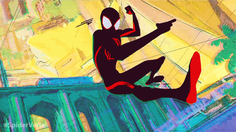

<picture>
  <source media="(prefers-color-scheme: dark)" srcset="https://raw.githubusercontent.com/atoatolobos11-del/atoatolobos11-del/output/bomberman-contribution-graph-dark.svg" />
  <source media="(prefers-color-scheme: light)" srcset="https://raw.githubusercontent.com/atoatolobos11-del/atoatolobos11-del/output/bomberman-contribution-graph.svg" />
  
</picture>
